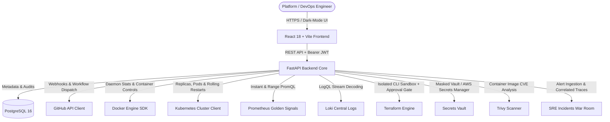

# OpsPilot 🚀 — Enterprise DevOps & Internal Developer Platform (IDP)

> **OpsPilot** is an open-source, production-style, self-hostable DevOps & Internal Developer Platform (IDP) and Observability suite. It bridges GitHub CI/CD, Docker daemon telemetry, Kubernetes workload orchestration, Terraform Infrastructure as Code, SRE Golden Signals (Prometheus, Loki, Grafana), zero-trust Secrets management, and Trivy security auditing into a single command center.

[-success?style=for-the-badge&logo=pytest)](file:///backend/tests)
[](file:///frontend)
[](file:///backend)
[](file:///frontend)
[](file:///docker-compose.yml)
[](file:///backend/app/services/kubernetes_service.py)
[](file:///backend/app/services/terraform_service.py)

---

## 🌟 Platform Capabilities & Architecture



### 1. Core Foundation
- **FastAPI Modular Backend**: Non-blocking asynchronous routes, Pydantic v2 schemas, and dependency-injected security.
- **Relational Schema**: PostgreSQL 16 schema mapped via SQLAlchemy ORM (Users, Teams, Projects, Pipelines, Pipeline Runs, Clusters, Deployments, Incidents, Alerts, Audit Logs, Secrets, Vulnerability Scans, Terraform Workspaces & Runs).
- **Security & RBAC**: JWT Bearer tokens with Bcrypt password hashing and role-based permissions (`admin`, `devops`, `developer`, `viewer`).

### 2. GitHub CI/CD & Delivery Pipelines
- **Asynchronous GitHub REST Client**: Dispatches GitHub Actions workflows, reads repositories, and inspects run outputs.
- **HMAC SHA-256 Webhooks**: Validates `X-Hub-Signature-256` headers to reject unauthorized webhook payloads.
- **5-Stage Pipeline Visualizer**: Real-time stage inspection (`Test` $\to$ `Build` $\to$ `Scan` $\to$ `Deploy` $\to$ `Verify`).

### 3. Docker Container & Image Management
- **Python Docker SDK**: Queries container CPU % and memory MB calculation, restart counts, and status.
- **Mutations & Log Streaming**: Safe `start`, `stop`, and `restart` actions with sensitive environment variable masking (`*KEY*`, `*SECRET*`, `*PASSWORD*`, `*TOKEN*`).

### 4. Kubernetes Workload Orchestration
- **Dual Config Loader**: Transparently queries local kubeconfig (`minikube`/`kind`) or in-cluster ServiceAccounts with safe offline fallbacks.
- **Workload Explorer**: Inspects Namespaces, Nodes, Pods, Deployments, Services, and Cluster Events.
- **Controlled Mutations**: Real-time replica scaling (`patch_namespaced_deployment_scale`) and zero-downtime rolling restart (`kubectl.kubernetes.io/restartedAt` patch).

### 5. Observability Suite (Prometheus, Loki, Grafana)
- **Google SRE 4 Golden Signals**: Native PromQL queries for CPU Utilization, Memory, HTTP Request Rate, 5xx Error Rate, and $p95$ Latency.
- **LogQL Log Streaming**: Filter logs by service label and severity level (`INFO`, `WARNING`, `ERROR`, `DEBUG`).
- **Grafana Workspace**: Deep-linked dashboards for unified metrics visualization.

### 6. Infrastructure as Code (Terraform Engine)
- **Isolated Workspace Sandbox**: Runs in isolated directories (`backend/terraform_workspaces/{workspace_id}`) with synchronized `main.tf` and `variables.tf`.
- **Regex Diff Parsing**: Automatically parses planned changes (`+ to add`, `~ to change`, `- to destroy`).
- **Strict Operator Approval Gate**: Workspaces with `requires_approval=True` strictly block `apply` with HTTP 403 Forbidden until an authorized operator issues explicit approval.

### 7. Zero-Trust Secrets Vault & AWS Integration
- **Secret Masking**: Secrets are stored encrypted and masked by default (`••••••••••••7890`).
- **AWS Secrets Manager Fallback**: Provider abstraction supporting local encrypted vault and AWS Secrets Manager.
- **Decryption Audit**: Plaintext reveal requires operator confirmation and writes an immutable audit event to `AuditLog`.

### 8. SRE Incidents War Room & Trivy Security Auditing
- **Correlated Telemetry**: Automatically queries Prometheus Golden Signal spikes and Loki error log streams, attaching empirical evidence directly to incidents.
- **Automated Alert Rules**: Evaluates PromQL threshold rules against live telemetry and auto-creates incidents when breached.
- **Trivy Container Scanner**: Detects Critical, High, Medium, and Low CVEs, installed vs fixed versions, and computes overall security letter grades (Grade A to F).
- **Non-Repudiation Audit Trail**: Searchable administrative event log tracking every action across the platform.

---

## 📂 Repository Layout

```text
Github_Monitoring/
├── backend/
│   ├── app/
│   │   ├── api/v1/          # Endpoints: auth, docker, github, incidents, kubernetes, logs, monitoring, pipelines, projects, security, terraform
│   │   ├── core/            # Database engine, JWT security, configuration settings
│   │   ├── models/          # SQLAlchemy Database entities (23 models)
│   │   ├── schemas/         # Pydantic v2 validation models
│   │   ├── services/        # Subprocess & SDK wrappers (Docker, K8s, Prometheus, Loki, Terraform, Security, Incident)
│   │   └── main.py          # FastAPI application entrypoint & lifespan
│   ├── tests/               # 27 automated unit & integration tests (100% pass rate)
│   ├── Dockerfile           # Backend container
│   └── requirements.txt     # Python dependencies
├── frontend/
│   ├── src/
│   │   ├── components/      # Layout, Sidebar, Navbar
│   │   ├── pages/           # Dashboard, Containers, Kubernetes, Metrics, Dashboards, Logs, Pipelines, Terraform, Incidents, Security
│   │   ├── services/        # Axios API client with token interceptors
│   │   └── App.jsx          # Protected route hierarchy
│   ├── Dockerfile           # Multi-stage production container
│   ├── package.json
│   └── vite.config.js
├── docker-compose.yml       # Full local stack: Postgres, Backend, Frontend, Prometheus, Loki, Grafana
├── Core.md                  # Complete OpsPilot product requirements
└── Plan.md                  # 8-Phase engineering delivery roadmap
```

---

## 🚀 Quick Start Guide

### Option 1: Full Stack via Docker Compose (Recommended)

1. Clone the repository:
   ```bash
   git clone https://github.com/ChirayuMarathe/Ops_Pilots.git
   cd Ops_Pilots
   ```

2. Start the entire platform (PostgreSQL, Backend, Frontend, Prometheus, Loki, Grafana):
   ```bash
   docker compose up -d --build
   ```

3. Access the interfaces:
   - **OpsPilot Web Console**: [http://localhost:3000](http://localhost:3000)
   - **FastAPI Interactive Docs**: [http://localhost:8000/api/v1/docs](http://localhost:8000/api/v1/docs)
   - **Prometheus Console**: [http://localhost:9090](http://localhost:9090)
   - **Grafana Dashboards**: [http://localhost:3001](http://localhost:3001)

---

### Option 2: Local Development Setup

#### 1. Backend Setup
```bash
cd backend
python -m venv venv

# Windows:
.\venv\Scripts\activate
# Linux/macOS:
source venv/bin/activate

pip install -r requirements.txt
uvicorn app.main:app --reload --port 8000
```

#### 2. Frontend Setup
```bash
cd frontend
npm install
npm run dev
```
Open [http://localhost:5173](http://localhost:5173).

#### 3. Run Automated Pytest Suite
```bash
backend\venv\Scripts\pytest -v backend/tests
```

```text
======================= 27 passed, 1 warning in 73.81s =======================
```

---

## 🛡 License
Licensed under the [MIT License](LICENSE).
