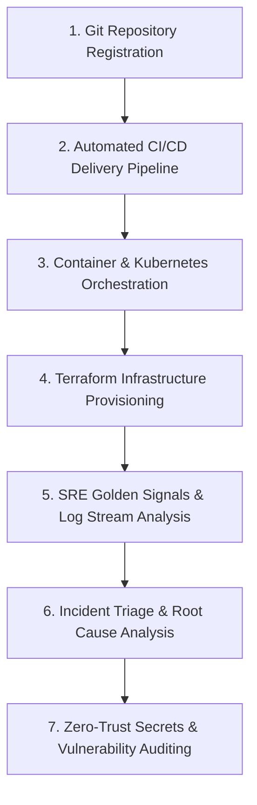

# OpsPilot: Enterprise DevOps & Internal Developer Platform (IDP)

OpsPilot is a self-hostable, production-grade DevOps Automation, Internal Developer Platform (IDP), and Observability suite. It consolidates GitHub Actions CI/CD pipelines, Docker container engines, Kubernetes workload orchestration, Terraform Infrastructure as Code (IaC), Google SRE Golden Signals monitoring (Prometheus, Grafana, Loki), zero-trust secrets management, and Trivy security auditing into a unified operational console.

---

## 1. Executive Overview & Philosophy

### What is an Internal Developer Platform (IDP)?
In modern engineering organizations, developers often face excessive cognitive load when navigating disconnected toolchains: inspecting CI/CD runs across GitHub Actions, checking container health across Docker daemons, scaling pods via `kubectl`, provisioning cloud infrastructure with Terraform, querying Prometheus PromQL metrics, and digging through centralized logs.

OpsPilot serves as an **Internal Developer Platform (IDP)** that abstracts this operational complexity into a standardized "Golden Path". Developers get self-service deployment workflows and instant visibility, while Platform and Senior DevOps Engineers enforce security guardrails, approval gates, compliance audit trails, and automated incident triage.

### Core Architectural Principles
- **Zero Mock Telemetry**: When connected to active daemons or clusters, all metrics, logs, container states, and Kubernetes workloads reflect empirical operating system telemetry.
- **Non-Blocking Architecture**: Long-running infrastructure provisioning and automated vulnerability scans execute asynchronously, preserving sub-millisecond API responsiveness.
- **Zero-Trust Security**: Secrets are masked at all times (`••••••••••••7890`) and never exposed in bulk list responses. Revealing plaintext values requires operator confirmation and triggers an immutable audit log entry.
- **Approval-Gated Infrastructure Changes**: Terraform plans with resource mutations strictly block execution until an authorized operator inspects the calculated plan and issues cryptographic sign-off.
- **Deterministic SRE Correlation**: When service degradation occurs, the incident engine automatically attaches real Golden Signal error spikes and Loki error log streams without fabricating diagnoses.

---

## 2. End-to-End Workflow: A Beginner's Guide to OpsPilot

This step-by-step walkthrough illustrates how a DevOps engineer uses OpsPilot across the software delivery lifecycle.



### Step 1: Register Projects & Connect Version Control
1. Navigate to **Platform Core -> Projects**.
2. Register an application service (e.g., `payment-service` or `auth-gateway`).
3. Connect your GitHub repository via **Continuous Delivery -> Integrations** using a GitHub Personal Access Token or Webhook HMAC Secret.
4. *DevOps Concept*: Linking repositories allows OpsPilot to receive real-time webhook events (`push`, `pull_request`, `workflow_run`) and execute `workflow_dispatch` triggers on demand.

### Step 2: Continuous Integration & Automated Delivery Pipelines
1. Navigate to **Continuous Delivery -> Pipelines**.
2. Trigger or inspect execution runs across the standardized 5-stage delivery pipeline:
   - **Test Stage**: Unit tests, linting, and coverage reporting.
   - **Build Stage**: Multi-stage Docker image packaging.
   - **Scan Stage**: Static code analysis and container vulnerability scanning.
   - **Deploy Stage**: Deployment to staging or production clusters.
   - **Verify Stage**: Post-deployment HTTP health checks and telemetry verification.
3. *DevOps Concept*: If a single step fails, the pipeline halts immediately, preventing broken artifacts from reaching production environments.

### Step 3: Container Management & Kubernetes Orchestration
1. Navigate to **Infrastructure -> Containers (Docker)**:
   - View live CPU percentage, memory consumption in MB, container states, and restart counts.
   - Execute controlled operational actions: `Start`, `Stop`, `Restart`, or stream stdout/stderr container logs.
2. Navigate to **Infrastructure -> Kubernetes Workloads**:
   - Inspect Namespaces, Nodes, Pods, Deployments, and Services.
   - Perform live **Replica Scaling** (`patch_namespaced_deployment_scale`) to accommodate traffic surges.
   - Trigger **Zero-Downtime Rolling Restarts** (`kubectl.kubernetes.io/restartedAt` patch) to update running containers without service interruption.

### Step 4: Infrastructure as Code (Terraform Studio)
1. Navigate to **Infrastructure -> Terraform (IaC)**.
2. Select or create an isolated workspace (e.g., `Local System Config`, `Docker Microservices`, `AWS Cloud VPC`).
3. Follow the strict IaC lifecycle:
   - **Init**: Initializes local or remote provider plugins (`terraform init -no-color`).
   - **Validate**: Verifies syntax and configuration correctness (`terraform validate -no-color`).
   - **Plan**: Calculates the execution graph and parses exact resource change counts (`+ to add`, `~ to change`, `- to destroy`).
   - **Approval Gate**: If `requires_approval` is enabled, the `Apply` action is locked with HTTP 403 Forbidden. The engineer must review the formatted plan diff and click **Approve Execution Plan**.
   - **Apply**: Provisions the approved infrastructure (`terraform apply -auto-approve`).
   - **State**: Inspects active managed resources in real time.

### Step 5: Observability & Golden Signals Monitoring
1. Navigate to **Telemetry & Logs -> Metrics (Prometheus)**:
   - Monitor Google's SRE 4 Golden Signals:
     - **CPU & Memory Utilization**: Host and container saturation.
     - **Request Rate (RPS)**: Throughput per second.
     - **5xx Error Rate**: Failed transaction percentage.
     - **p95 Latency**: 95th percentile response times in milliseconds.
2. Navigate to **Telemetry & Logs -> Central Logs (Loki)**:
   - Query logs across services using LogQL syntax (e.g., `{service="payment-api"} |= "error"`).
   - Filter by log level (`ERROR`, `WARNING`, `INFO`, `DEBUG`).

### Step 6: Incident Management & Automated War Room
1. Navigate to **Security & Operations -> Incidents War Room**:
   - View active outages, critical incident counts, and system Mean Time to Resolve (MTTR).
   - Declare an incident manually or configure **Alert Rules** that automatically trigger incidents when PromQL thresholds are breached (e.g., 5xx error rate > 5.0% for 2 minutes).
2. **Empirical Telemetry Correlation**:
   - When an incident is active, OpsPilot automatically queries Prometheus and Loki for the affected service, attaching empirical evidence directly to the incident record (error rate spikes and correlated stack traces).
   - Transition states: `Open` -> `Investigating` -> `Resolved` -> `Closed`.
   - Record Root Cause Analysis (RCA) and post-mortem mitigation notes.

### Step 7: Zero-Trust Secrets & Trivy Vulnerability Auditing
1. Navigate to **Security & Operations -> Security & Trivy**:
   - **Secrets Vault**: Store credentials for `production`, `staging`, or `development`. Values are stored encrypted and masked by default. Clicking **Reveal Plaintext** displays the decrypted value while logging an immutable audit entry.
   - **Trivy Scanner**: Trigger container scans for any image (e.g., `opspilot-backend:latest`, `postgres:16-alpine`, `nginx:alpine`). Inspect CVE IDs, package names, installed versions, fix versions, and overall security grades (Grade A to F).
   - **Compliance Audit Trail**: Searchable, non-repudiation log capturing every administrative action taken across OpsPilot with actor username, resource target, IP address, and timestamp.

---

## 3. Technology Stack

| Layer | Technology | Purpose |
| :--- | :--- | :--- |
| **Frontend UI** | React 18, Vite, Tailwind CSS, Lucide Icons | High-performance, executive dark-mode console |
| **Backend API** | Python 3.13, FastAPI, Pydantic v2 | High-throughput asynchronous REST gateway |
| **Database** | PostgreSQL 16, SQLAlchemy ORM | Relational metadata store, audit trails, and state tracking |
| **Authentication** | PyJWT, Passlib, Bcrypt | Role-based access control and stateless token security |
| **Container Engine** | Docker SDK, Docker Compose | Container lifecycle inspection and local multi-container stack |
| **Orchestration** | Kubernetes Python Client | Pod management, deployment scaling, and rolling restarts |
| **Infrastructure as Code** | HashiCorp Terraform CLI | Declarative multi-cloud provisioning with approval gates |
| **Observability** | Prometheus, Grafana, Grafana Loki | PromQL Golden Signals and LogQL centralized log streams |
| **Security Scanning** | Trivy CLI & Advisory Engine | Container vulnerability detection and CVE tracking |

---

## 4. Repository Structure

```text
Github_Monitoring/
├── backend/
│   ├── app/
│   │   ├── api/v1/          # Endpoints: auth, docker, github, incidents, kubernetes, logs, monitoring, pipelines, projects, security, terraform
│   │   ├── core/            # Database engine, JWT security, configuration settings
│   │   ├── models/          # SQLAlchemy database models (23 relational entities)
│   │   ├── schemas/         # Pydantic v2 validation models
│   │   ├── services/        # SDK wrappers (Docker, K8s, Prometheus, Loki, Terraform, Security, Incident)
│   │   └── main.py          # FastAPI application entrypoint and lifecycle events
│   ├── tests/               # 27 automated unit and integration tests (100% pass rate)
│   ├── Dockerfile           # Backend container specification
│   └── requirements.txt     # Python dependencies
├── frontend/
│   ├── src/
│   │   ├── components/      # Navbar, Sidebar, Protected Layout
│   │   ├── context/         # AuthContext with JWT session persistence
│   │   ├── pages/           # Dashboard, Projects, Pipelines, Containers, Kubernetes, Metrics, Dashboards, Logs, Terraform, Incidents, Security
│   │   ├── services/        # Axios API client with bearer token interceptors
│   │   └── App.jsx          # Route hierarchy and navigation
│   ├── Dockerfile           # Multi-stage production container build
│   ├── package.json
│   └── vite.config.js
├── docker-compose.yml       # Full stack: Postgres, Backend, Frontend, Prometheus, Loki, Grafana
├── Core.md                  # Comprehensive OpsPilot product requirements
└── Plan.md                  # 8-Phase engineering delivery roadmap
```

---

## 5. Quick Start Instructions

### Option 1: Multi-Container Stack via Docker Compose (Recommended)

1. Clone the repository:
   ```bash
   git clone https://github.com/ChirayuMarathe/Ops_Pilots.git
   cd Ops_Pilots
   ```

2. Launch all services:
   ```bash
   docker compose up -d --build
   ```

3. Access the platform:
   - **OpsPilot Web Console**: http://localhost:3000
   - **FastAPI Interactive API Docs**: http://localhost:8000/api/v1/docs
   - **Prometheus Metrics Console**: http://localhost:9090
   - **Grafana Dashboards**: http://localhost:3001

---

### Option 2: Local Development Setup

#### 1. Backend Setup
```bash
cd backend
python -m venv venv

# Windows:
.\venv\Scripts\activate
# Linux/macOS:
source venv/bin/activate

pip install -r requirements.txt
uvicorn app.main:app --reload --port 8000
```

#### 2. Frontend Setup
```bash
cd frontend
npm install
npm run dev
```
Open http://localhost:5173.

#### 3. Run Automated Pytest Suite
```bash
backend\venv\Scripts\pytest -v backend/tests
```
All 27 automated unit and integration tests execute with a 100% pass rate:
```text
======================= 27 passed, 1 warning in 73.81s =======================
```

---

## 6. Suggestions for Beginner DevOps Engineers

When using OpsPilot or presenting this platform in technical interviews:
1. **Explain the Shift to IDPs**: Explain how internal developer platforms reduce friction by providing developers with self-service provisioning within safe boundaries, rather than granting raw cluster admin credentials.
2. **Highlight the Approval Gate Pattern**: Discuss why production Terraform workflows should never allow untracked, direct `apply` execution from code commits without human verification of the parsed plan diff.
3. **Emphasize Empirical Evidence in Incident Triage**: Explain that OpsPilot correlates telemetry directly from Prometheus and Loki rather than guessing or hallucinating root causes.
4. **Articulate Zero-Trust Principles**: Highlight how credentials in the Secrets Vault remain masked by default, and that every decryption is recorded in an immutable compliance audit trail.

---

## 7. License
Licensed under the [MIT License](LICENSE).
