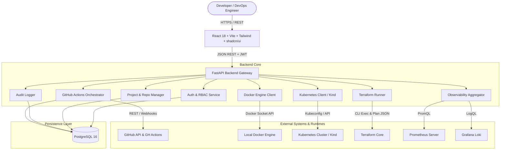
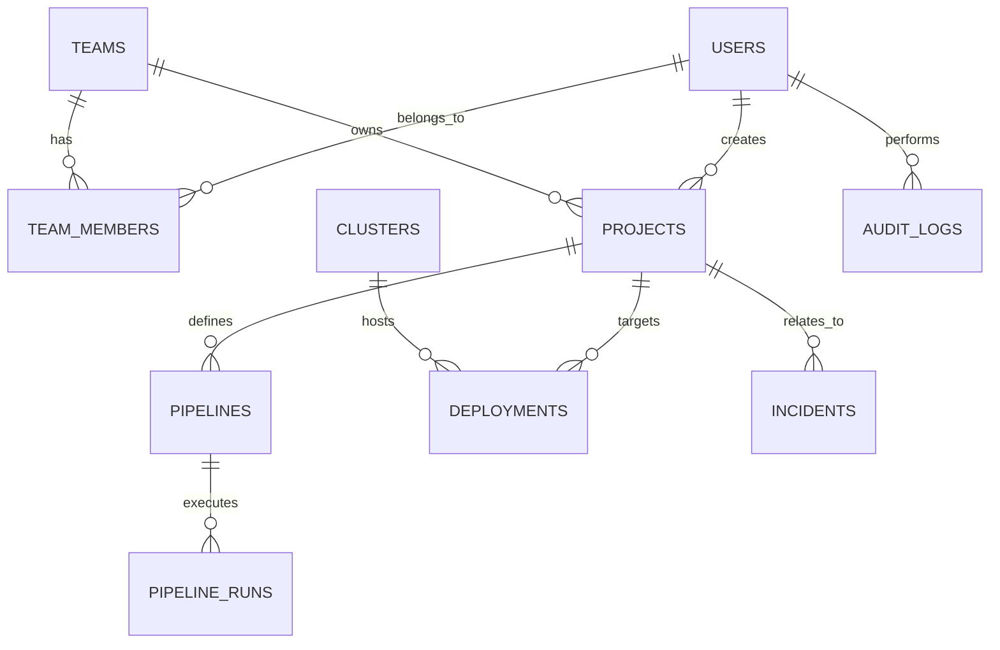

# OpsPilot: System Architecture & Specification Document

## 1. Executive Summary
OpsPilot is an Internal Developer Platform (IDP) and Observability Hub engineered to unify DevOps workflows into a secure, single-pane-of-glass management console. It orchestrates GitHub repositories, GitHub Actions CI/CD workflows, Docker container runtimes, Kubernetes workloads, Terraform infrastructure-as-code modules, and Grafana/Prometheus/Loki observability stacks.

---

## 2. High-Level Architecture

---

## 3. Database Schema (PostgreSQL & SQLAlchemy)

### 3.1 Entity Relationship Diagram

### 3.2 Entities Definition

1. **`users`**
   - `id`: UUID (Primary Key)
   - `email`: VARCHAR(255), Unique, Indexed
   - `username`: VARCHAR(100), Unique, Indexed
   - `hashed_password`: VARCHAR(255)
   - `full_name`: VARCHAR(255)
   - `is_active`: BOOLEAN, default `True`
   - `is_superuser`: BOOLEAN, default `False`
   - `role`: VARCHAR(50), default `'developer'` (admin, devops, developer, viewer)
   - `created_at`: TIMESTAMPTZ
   - `updated_at`: TIMESTAMPTZ

2. **`teams`** & **`team_members`**
   - Organization multi-tenancy, user membership, and RBAC permissions.

3. **`projects`**
   - `id`: UUID (Primary Key)
   - `name`: VARCHAR(100), Indexed
   - `slug`: VARCHAR(120), Unique, Indexed
   - `description`: TEXT
   - `repository_url`: VARCHAR(255)
   - `default_branch`: VARCHAR(100), default `'main'`
   - `owner_id`: UUID (FK -> users.id)
   - `created_at`: TIMESTAMPTZ
   - `updated_at`: TIMESTAMPTZ

4. **`pipelines`** & **`pipeline_runs`**
   - Connects to GitHub Actions workflows, tracking git commit hash, triggering actor, status (queued, in_progress, success, failure), logs, and duration.

5. **`clusters`** & **`deployments`**
   - Records Kubernetes cluster connectivity details (context, kind / EKS, health status) and deployments.

6. **`incidents`** & **`alerts`**
   - Incident tracking with severity (critical, high, medium, low), affected service, root cause evidence, and resolution states.

7. **`audit_logs`**
   - Immutable security trail: `id`, `user_id`, `action`, `resource_type`, `resource_id`, `ip_address`, `payload`, `timestamp`.

---

## 4. REST API Endpoint Plan

### 4.1 Authentication & Profile (`/api/v1/auth`)
- `POST /api/v1/auth/register` — Create initial user account.
- `POST /api/v1/auth/login` — Authenticate and retrieve JWT Bearer token.
- `GET  /api/v1/auth/me` — Retrieve authenticated user profile and roles.
- `POST /api/v1/auth/refresh` — Refresh expired access token.

### 4.2 System Health & Status (`/api/v1/health`)
- `GET  /api/v1/health` — Liveness and readiness probes checking DB and subsystem statuses.

### 4.3 Projects Management (`/api/v1/projects`)
- `GET    /api/v1/projects` — List user's registered projects.
- `POST   /api/v1/projects` — Register new project linked to a Git repository.
- `GET    /api/v1/projects/{id}` — Get single project details and latest stats.
- `PUT    /api/v1/projects/{id}` — Update project configuration.
- `DELETE /api/v1/projects/{id}` — Archive or delete project.

### 4.4 Dashboard Overview (`/api/v1/dashboard`)
- `GET /api/v1/dashboard/summary` — Aggregate metrics: Total projects, active deployments, healthy services, active incidents, and infrastructure health.

---

## 5. Phase-by-Phase Roadmap

* **Phase 1: Foundation (Current)**
  - Repository structure, Docker Compose (PostgreSQL, Backend, Frontend).
  - FastAPI backend with JWT authentication, password hashing (bcrypt), SQLAlchemy models, and Alembic migrations.
  - React + Vite + Tailwind CSS frontend with Dark Theme, Navbar, Sidebar, Login, Registration, and Protected Dashboard.
  - Unit and integration tests for authentication and health endpoints.
* **Phase 2: GitHub Integration & CI/CD**
  - GitHub OAuth, repository selection, webhook signature validation, and GitHub Actions pipeline tracker.
* **Phase 3: Docker Integration**
  - Docker engine client, listing containers/images, container inspect, logs, and restart monitoring.
* **Phase 4: Kubernetes Integration**
  - Local `kind` cluster setup, pods, deployments, service discovery, pod logs, replica scaling, and safe rollbacks.
* **Phase 5: Observability (Prometheus, Grafana, Loki)**
  - PromQL query integration, Grafana dashboard embedding, and centralized Loki log viewer.
* **Phase 6: Infrastructure as Code (Terraform)**
  - Isolated Terraform runner (`init`, `validate`, `plan`, plan visualization, and approval-gated `apply`).
* **Phase 7: AWS Infrastructure & Cloud Security**
  - AWS credential configuration, IAM role checks, and AWS Secrets Manager integration.
* **Phase 8: Incidents, Trivy Scanning & Audit Trails**
  - Automated incident triggers from alert thresholds, Trivy image vulnerability scanning, and audit trail viewing.

